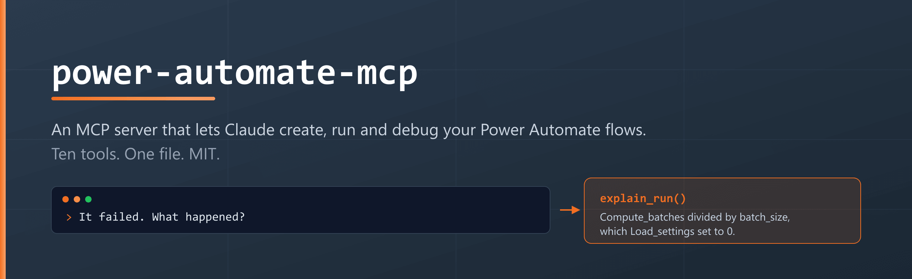
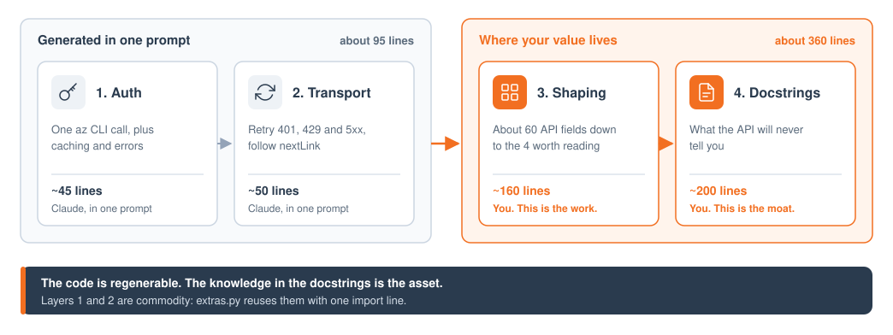
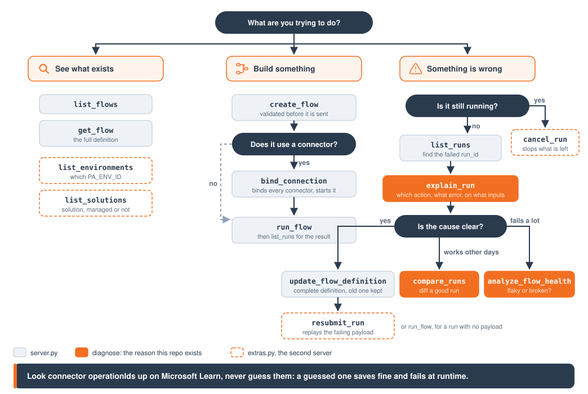
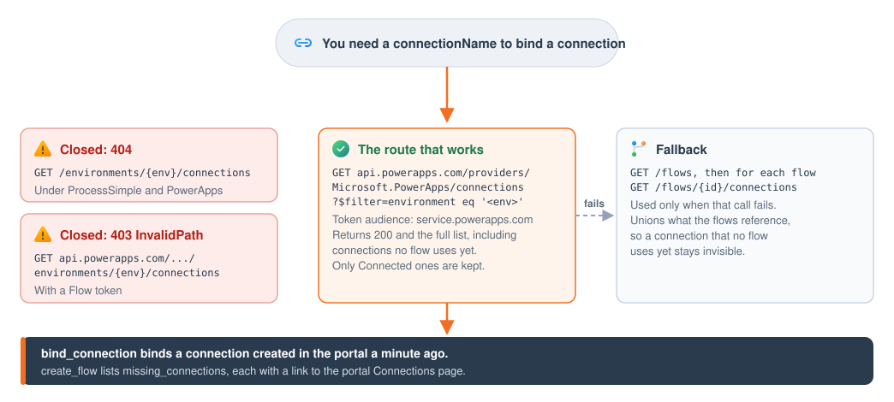

# power-platform-mcp

[](https://github.com/OwnOptic/power-platform-mcp/actions/workflows/ci.yml)

**An MCP server that lets Claude create, run, and debug your Power Automate flows, and build Copilot Studio agents.**
Renamed from `power-automate-mcp` on 4 November 2026: it now covers both sides of the Power Platform
an agent builder touches. Old links and clones keep working through GitHub's redirect.
One file. Ten tools. Built as a teaching artifact for a community talk on why you
should build your own MCP servers instead of waiting for someone to ship you one.
Nine more tools for real work - environments, start and stop, cancel, resubmit,
solutions - live in a second server, [`extras.py`](#running-extraspy).

## The short version

**What it does.** Claude can list, build, run and fix your flows. When a run fails,
`explain_run` tells you *why*: it fetches the real error that Power Automate hides
behind a link, and shows the value from an earlier step that caused it.

**What you need.** Python 3.10+, the [Azure CLI](https://learn.microsoft.com/cli/azure/install-azure-cli),
and a Power Platform environment. No app registration, no secret: it signs in with
your own `az login`.

**Set it up.**

```bash
git clone https://github.com/OwnOptic/power-platform-mcp.git
cd power-platform-mcp
pip install -r requirements.txt
az login
```

Then add this to `.mcp.json` (Claude Code), with absolute paths:

```json
{
  "mcpServers": {
    "power-platform":         { "command": "python", "args": ["/absolute/path/to/server.py"] },
    "power-platform-extras":  { "command": "python", "args": ["/absolute/path/to/extras.py"] },
    "power-platform-copilot": { "command": "python", "args": ["/absolute/path/to/copilot_studio.py"] },
    "microsoft-learn": { "type": "http", "url": "https://learn.microsoft.com/api/mcp" }
  }
}
```

`power-platform` alone is the ten-tool core. `-extras` adds environments, start and stop,
cancel, resubmit and solutions; `-copilot` adds Copilot Studio agents. `microsoft-learn`
lets Claude look up connector actions in Microsoft's documentation instead of guessing
them. Use the same Python for all three - the venv one, if you made one. On Claude
Desktop, put the local servers in `claude_desktop_config.json` and add the Learn URL under
Settings > Connectors.

Everything runs **locally**: each person runs their own copy, signed in as themselves.
There is no shared server and nothing to host.

**Try it.** Restart your client, then ask:

- "List my flows."
- "Why did *flow name* fail last night?"
- "Create a flow from demo-flow.json and run it." (It is meant to fail. Then ask why.)

> **Use a test environment.** The server acts as you, so it can change anything you
> can. If your `az` is signed in to more than one tenant, give the server its own
> `az` profile for the demo tenant - see [One az profile per tenant](#one-az-profile-per-tenant) -
> and pin it with `PA_TENANT_ID=<tenant id>` in a `.env` file next to `server.py`.
>
> For the skills that manage solutions, install the
> [Power Platform CLI](https://learn.microsoft.com/power-platform/developer/cli/introduction)
> (`pac`) too. The MCP servers do not need it.

Everything below is the long version: how it works, the Power Automate traps it
handles, and why you might build your own.

## What it looks like

```
> Create a flow from demo-flow.json and run it.

  create_flow  -> DEMO - nightly batch (8a3f...), Started
  run_flow     -> accepted

> It failed. What happened?

  list_runs    -> 08d8...: Failed
  explain_run  -> Compute_batches failed:
                  "Unable to process template language expressions in action
                   'Compute_batches' inputs at line '0' and column '0':
                   'Attempt to divide an integral or decimal value by zero
                    in function 'div'.'."
                  Load_settings emitted {"region": "westeurope", "retries": 3,
                  "batch_size": 0} and Compute_batches divides 120 by batch_size.

> Fix it and run it again.

  get_flow                 -> definition retrieved
  update_flow_definition   -> batch_size: 0 -> 4
  run_flow                 -> accepted
  list_runs                -> 08d8...: Succeeded, output 30
```

That entire loop is four tool calls the model chose on its own, because the tools
tell it what they are for.

### Watch it, or present it

<a href="https://player.cloudinary.com/embed/?cloud_name=dapoc7ekn&profile=cld-default&public_id=portfolio/remotion/power-platform-mcp-en"></a>

Click to play the three-minute explainer. En français : [la version française](https://player.cloudinary.com/embed/?cloud_name=dapoc7ekn&profile=cld-default&public_id=portfolio/remotion/power-platform-mcp-fr).

- **Three-minute explainer**, voiced, captioned, built with [Remotion](video/) from the
  outputs of a real run: [English](docs/video/power-platform-mcp-en.mp4) |
  [français](docs/video/power-platform-mcp-fr.mp4)
- **A 30-minute live demo script** - install, build and debug a flow, give a Copilot
  Studio agent a tool, skills and solutions with `pac`, write your own skill:
  [English](docs/demo/DEMO-SCRIPT.en.md) | [français](docs/demo/DEMO-SCRIPT.fr.md)

The video is generated, not recorded: `video/narration.json` holds the script in both
languages, `python video/make_voice.py` voices it (neural voices, Swiss French for the
French cut), and `node video/render.mjs` renders both. Change a sentence, re-run two
commands, and the captions and timings follow.

And when the error is clear but the *reason* is not:

```
> This flow works most days. Why did it fail last night?

  compare_runs        -> diverged at Compute_batches, but Load_settings emitted
                         batch_size: 0 where the working run emitted 4.
                         Symptom and cause are different actions.
  analyze_flow_health -> 18% failure rate over 50 runs, 5 of 5 sampled failures
                         all in Get_items. Flaky and concentrated, not broken.
```

---

## Table of contents

- [Watch it, or present it](#watch-it-or-present-it)
- [Why this exists](#why-this-exists)
- [The tool that justifies the exercise](#the-tool-that-justifies-the-exercise)
- [Quick start](#quick-start) - [let Claude install it](#let-claude-install-it)
- [Architecture: the four layers](#architecture-the-four-layers) - [transport: run it over stdio](#transport-run-it-over-stdio)
- [Tool reference](#tool-reference) - [companion server: Microsoft Learn MCP](#companion-server-microsoft-learn-mcp)
- [Gotchas this server encodes](#gotchas-this-server-encodes)
- [The demo flow](#the-demo-flow)
- [Extending it](#extending-it) - [tests](#tests)
- [Skills: the layer above docstrings](#skills-the-layer-above-docstrings)
- [Troubleshooting](#troubleshooting)
- [Security](#security)
- [What is deliberately missing](#what-is-deliberately-missing)
- [Compared with Microsoft's plugin](#compared-with-microsofts-plugin)
- [FAQ](#faq)

---

## Why this exists

Every useful MCP server is four layers. Only two of them are interesting.

| Layer | What it does | Lines here | Who writes it |
| --- | --- | --- | --- |
| **1. Auth** | Get a token | ~45 | Claude, in one prompt |
| **2. Transport** | Call, retry, paginate | ~50 | Claude, in one prompt |
| **3. Shaping** | Turn API JSON into model-readable JSON | ~160 | **You. This is the work.** |
| **4. Docstrings** | Teach the model what the API will not | ~200 | **You. This is the moat.** |



Wrapping an API is not the point, and it is precisely the part you can automate.
The value is in deciding what to hand the model, and in writing down what you
learned so that you never learn it twice.

Two concrete examples from this repo.

**Shaping.** `list_flows` returns four fields per flow. The API returns about sixty,
mostly GUIDs and internal plumbing. Handing the raw payload to a model burns
context, buries the signal, and makes the model slower and less accurate. Deciding
what to drop is a judgement call that no code generator can make for you, because
it depends on what you actually do with flows.

**Docstrings.** `create_flow` documents that a connector flow will fail with HTTP
400 unless the definition declares `$connections` and `$authentication`, and that
the error message blames the *trigger*, which sends you hunting in entirely the
wrong place. That cost real hours to discover once. It now costs nobody anything,
forever, including every future model that reads this docstring.

The code is regenerable. The accumulated knowledge in the docstrings is the asset.

---

## The tool that justifies the exercise

`explain_run` is the tool a generic HTTP wrapper cannot give you, and it is worth
understanding why before you read any other code here.

**For connector failures, Power Automate does not put the error message on the
action record.** A failed connector action comes back looking like this - measured,
against a real Teams action posting to a channel that does not exist:

```json
{
  "name": "Post_message",
  "properties": {
    "status": "Failed",
    "code": "NotFound",
    "outputsLink": {
      "uri": "https://<env>.environment.api.powerplatformusercontent.com/.../ActionOutputs?...&sig=...",
      "contentSize": 285
    }
  }
}
```

There is no `error` property at all. The real message lives inside a blob behind
that short-lived signed URL. The portal follows the link for you, which is exactly
why the portal shows you a real error and a naive API wrapper shows you `Failed`
and nothing else.

**Which failures actually behave this way.** This matters, and getting it wrong
sends you chasing the wrong demo:

| failure | `error` on the action | `outputsLink` |
|---|---|---|
| expression / `InvalidTemplate` (divide by zero, bad reference) | **inline, complete** | absent |
| connector action (HTTP 4xx/5xx from Teams, SharePoint, Outlook) | **absent** | **present** |

So an expression error needs no second hop, and a connector-free flow can never
demonstrate this problem. `demo-flow.json` is the first kind; `demo-flow-connector.json`
is the second, and it exists precisely to exercise this path.

**And which field inside the blob.** `error.message` is routinely just the code
restated - a real Teams 404 gives `{"code": "NotFound", "message": "NotFound"}`,
which tells you nothing. The diagnosis is one level down:

```json
"innerError": {
  "message": "LocationLookupFailed-Location lookup failed for thread 19:...@thread.tacv2"
}
```

That names the offending value outright. `_resolve_error` prefers `innerError`,
prefixes the HTTP status, and drops the code when it merely repeats the message,
so you get one line: `404 NotFound: LocationLookupFailed-Location lookup failed
for thread 19:...@thread.tacv2`.

`explain_run` does two things a wrapper does not:

1. **It follows the link.** For every failed action, it fetches the outputs blob
   and digs the message out, so the model receives resolved error text rather
   than `null`.
2. **It supplies upstream context.** A failure is rarely explained by the failing
   action alone. The cause is almost always in what an earlier action produced.
   So the response pairs each failed action with the outputs of the actions that
   succeeded before it, in execution order.


One tool call. The equivalent of about a dozen clicks through the run history view.
That gap is the entire argument for building your own MCP server.

---

## Quick start

### Let Claude install it

If you already have Claude Code or Claude Desktop, paste the prompt below and it will
do the whole setup: check your prerequisites, clone, install, authenticate, wire the
server into your MCP client, verify it, and optionally walk the demo debug loop.

It is written to stop and ask before anything that touches your tenant, and it never
prints a token.

````text
Set up the power-platform-mcp server on my machine, from
https://github.com/OwnOptic/power-platform-mcp

Work through the phases in order. After each phase, report what you found in one or
two lines. If a check fails in a way not covered below, stop and tell me rather than
improvising.

RULES THAT OVERRIDE EVERYTHING ELSE
- Never print, echo, log or write an access token anywhere. Pipe tokens into
  variables, never to stdout.
- Never run `az login --service-principal`, and never ask me for a password or a
  client secret. This setup needs neither.
- Do not create, update, run or delete any Power Automate flow until I have
  explicitly confirmed the tenant in PHASE 2 and said yes in PHASE 6.
- If a command fails, show me its actual error text. Do not paraphrase it.

PHASE 0 - Inspect only, change nothing
1. Detect my OS and shell.
2. Run `python --version` (and `python3 --version` if that fails). Need 3.10 or later.
   If it is older or missing, stop and tell me.
3. Run `az version`. If the Azure CLI is missing, stop and give me the install link
   for my OS: https://learn.microsoft.com/cli/azure/install-azure-cli
4. Report OS, Python version, az version, and the directory you propose to clone into.

PHASE 1 - Code and dependencies
5. Clone the repo into that directory. If it already exists, `git pull` instead.
6. Create a virtual environment inside it and use it for everything that follows.
   Tell me the exact interpreter path, I will need it in PHASE 4.
7. `pip install -r requirements.txt`. That file is a lockfile, so expect around
   forty pinned packages, not three - `mcp`, `httpx` and `python-dotenv` are the
   direct ones, the rest are their transitives. Confirm the install succeeded.
8. Sanity check the code imports and registers its tools without any environment
   variables set. It should report 10 tools:
   `python -c "import asyncio, server; print(len(asyncio.run(server.mcp.list_tools())))"`
   Run it from the repo directory. If this fails, stop.

PHASE 2 - Authenticate, then STOP for my confirmation
9. Run `az account show`. If it errors, or reports an expired session
   (AADSTS70043), run `az login` and let me complete it in the browser.
10. Show me the tenant id and the signed-in user, and ASK ME TO CONFIRM this is the
    tenant I want. Do not continue until I say yes.
    This matters: the server creates, edits and runs REAL flows with my delegated
    permissions. It can do anything I can do. If the account looks like a production
    or client tenant, say so explicitly and recommend I switch with
    `az login --tenant <id>`.
11. Once I confirm, check the Azure CLI is consented for the Flow audience WITHOUT
    printing the token:
    `az account get-access-token --resource "https://service.flow.microsoft.com/" --query expiresOn -o tsv`
    - A timestamp means it works. Continue.
    - AADSTS65001 (consent) means my tenant has not consented the Azure CLI for this
      audience. Stop and tell me. This server deliberately has no app-registration
      fallback, so setup cannot continue.
    - AADSTS70043 means the session aged out under Conditional Access. Run
      `az login` again.

PHASE 3 - Target environment
12. By default the server uses `Default-<tenantId>`, resolved automatically from the
    Azure CLI. Ask whether I want a different environment.
13. Only if I do: create a `.env` in the repo root containing a single line,
    `PA_ENV_ID=<the environment GUID>`. Otherwise create no .env at all. There is
    nothing else to configure and no secret to store.

PHASE 4 - Wire it into my MCP client
14. Ask which client I use, or detect it.
15. For Claude Code, add to `.mcp.json` in my project root. For Claude Desktop, use
    `%APPDATA%\Claude\claude_desktop_config.json` on Windows or
    `~/Library/Application Support/Claude/claude_desktop_config.json` on macOS.
16. Back up the file before editing if it already exists.
17. Add this entry, with the venv interpreter from step 6 and an ABSOLUTE path to
    server.py:

    {
      "mcpServers": {
        "power-platform": {
          "command": "<absolute path to the venv python>",
          "args": ["<absolute path to server.py>"]
        },
        "microsoft-learn": {
          "type": "http",
          "url": "https://learn.microsoft.com/api/mcp"
        }
      }
    }

    The second entry is the Microsoft Learn MCP server, which the model uses to look
    up connector operationIds instead of guessing them. It is hosted by Microsoft,
    read-only, and needs no sign-in. For Claude Desktop, leave it out of the JSON and
    add https://learn.microsoft.com/api/mcp under Settings > Connectors > Add custom
    connector instead - the JSON file is for local servers.

18. Show me the exact file path you changed and the exact block you added. If the
    file already had other MCP servers, merge into the existing mcpServers object
    rather than replacing it.

PHASE 5 - Verify, read-only
19. Tell me to fully restart my MCP client, and wait for me to confirm I have.
20. Ask me to run: "List my flows."
21. Expect flow_id, display_name, state for each flow. Interpret the result:
    - Flows listed: setup is working, all four layers are live.
    - Empty list: auth works but the environment has no flows, or it is the wrong
      environment.
    - 404: wrong environment. Get the GUID from the make.powerautomate.com URL and
      set PA_ENV_ID as in step 13.
    - "Run `az login` first": the CLI session died. Re-run `az login`.
22. If Microsoft Learn was added, ask me to run: "What is the operationId for posting
    a message to a Teams channel?" Expect `PostMessageToConversation`, cited from
    learn.microsoft.com/connectors/teams. Anything else means the model answered
    from memory rather than calling the Learn server.

PHASE 6 - Optional end-to-end demo. ASK BEFORE STARTING.
23. Explain to me first, then wait for a yes:
    This creates a REAL flow called "DEMO - nightly batch" in the tenant I confirmed,
    from demo-flow.json in the repo. That flow is DELIBERATELY BROKEN: Load_settings
    emits batch_size 0 and Compute_batches divides 120 by it. The run is SUPPOSED to
    fail. That failure is the whole point of the demo.
    It is connector-free (button trigger plus two Compose actions), so it needs no
    connection binding and touches no business data.
24. On my yes, in order: create_flow from demo-flow.json, run_flow, list_runs,
    then explain_run on the failed run.
25. Expected result, tell me whether it matches: explain_run names Compute_batches as
    the failed action, resolves the error to "The template language function 'div'
    was invoked with a divisor of zero", and shows Load_settings outputting
    batch_size 0. Symptom and cause are different actions, which is the point.
26. Then offer to close the loop: update_flow_definition setting batch_size to 4,
    run_flow again, list_runs. Expect Succeeded with output 30.
27. Finally, remind me the demo flow still exists and this server has no delete tool
    on purpose, so I should remove "DEMO - nightly batch" from the maker portal when
    I am done.

When everything is done, give me a short summary: where the repo lives, which
interpreter runs it, which tenant and environment it is pointed at, which config
file you edited, and anything that needed a workaround.
````

<details>
<summary>Prefer to do it by hand? The manual steps are below.</summary>

### Prerequisites

- Python 3.10 or later
- A Power Platform environment you can create flows in
- The [Azure CLI](https://learn.microsoft.com/cli/azure/install-azure-cli), signed in
  with [`az login`](#1-sign-in). That is the entire auth story: no app registration,
  no admin consent, no client id, no secret
- An MCP client: Claude Code, Claude Desktop, or anything else that speaks MCP

> **Use a demo or development tenant.** This server creates, edits, and runs real
> flows with your delegated permissions. It can do anything you can do.

### 1. Sign in

```bash
az login
```

That is the entire setup.

The server needs a token for the `https://service.flow.microsoft.com` audience. The
Azure CLI is itself a Microsoft first-party app that your tenant already trusts, so
it will hand you one. **No app registration, no admin consent, no device code, no
client id, no secret.** The server reads your tenant and default environment from
whatever the CLI is signed in to.

This is the same trick the `Microsoft.PowerApps.PowerShell` module uses when
`Add-PowerAppsAccount` followed by `Get-Flow` lists your flows without you having
registered anything.

Check you are pointed at the right place before going further:

```bash
az account show --query "{tenant:tenantId, user:user.name}"
```

> **One caveat, worth knowing up front.** Being first-party is not automatically
> sufficient in every tenant. Conditional Access and pre-authorization policies vary,
> and Microsoft's own Work IQ CLI app, for instance, does *not* carry
> `service.flow.microsoft.com` in its allowed resources at all. If your tenant refuses
> the Azure CLI for this audience you will see a consent error such as `AADSTS65001`,
> and you would need your own app registration - which this server deliberately does
> not implement, to keep Layer 1 down to one shell call.

### 2. Install

```bash
git clone https://github.com/OwnOptic/power-platform-mcp.git
cd power-platform-mcp
pip install -r requirements.txt
```

Three direct dependencies - `mcp`, `httpx`, `python-dotenv` - plus the Azure CLI.
(`typing-extensions` is declared too, because `server.py` imports it, but it arrives
with `mcp` anyway.)

`requirements.txt` is a **lockfile**: every package pinned to an exact version,
transitives included, so you get the same tree this was tested against rather than
whatever resolves today. Edit [`requirements.in`](requirements.in) to change a
dependency, then regenerate:

```bash
uv pip compile requirements.in --universal --python-version 3.10 -o requirements.txt
```

`--universal` resolves for every OS at once and emits environment markers, so one
lockfile covers Windows, macOS and Linux.

> **This runs on `mcp` 2.x.** If you are upgrading an older clone and see
> `No module named 'mcp.server.fastmcp'`, your code and your installed SDK are a
> major version apart: `git pull`, then `pip install -r requirements.txt` again. The
> port itself was a one-line rename plus one behaviour change worth knowing about
> before you port your own server; see
> [gotcha 9](#9-mcp-2x-hides-the-text-of-every-exception-that-is-not-a-toolerror).

### 3. Configure

**There is nothing to configure.** The server resolves your tenant and default
environment from the Azure CLI, and there is no client id, no secret and no `.env`
required. Skip to step 4.

Two optional settings, both about *which tenant and environment you land in*:

```ini
# Optional. Find the GUID in the make.powerautomate.com URL after switching environment.
PA_ENV_ID=Default-00000000-0000-0000-0000-000000000000

# Strongly recommended if you have ever run `az login` against more than one tenant.
PA_TENANT_ID=00000000-0000-0000-0000-000000000000
```

**Set `PA_TENANT_ID` if you are a consultant, or on any machine with more than one
tenant in `az`.** Borrowing the CLI's token means borrowing whichever account is
*active*, and `az` holds many at once. `az account show` on a consultant's laptop is
quite often a client's production service principal - at which point this server will
cheerfully create and run flows in that client's tenant. Pinning makes the server
declare the tenant it is for; if the active account cannot reach it you get a loud
AADSTS50020 instead of a quiet write in the wrong place.

It is a guard, not a switch. It will not go and find the right logged-in account for
you - it only stops you using the wrong one. Unset is fine on a single-tenant machine
and a live grenade on any other.

#### One az profile per tenant

The switch is a separate Azure CLI profile. `az` keeps everything in one folder, and
`AZURE_CONFIG_DIR` points it at another, so the server can live in the demo tenant while
your own terminal stays wherever your day job is:

```powershell
$env:AZURE_CONFIG_DIR = "$HOME\.azure-demo"
az login --tenant <demo tenant id>
az account show --query "{tenant:tenantId, user:user.name}"
```

Then give each server the same folder in `.mcp.json`:

```json
"power-platform": {
  "command": "python", "args": ["/absolute/path/to/server.py"],
  "env": { "AZURE_CONFIG_DIR": "C:/Users/you/.azure-demo" }
}
```

Your everyday `az` (and its active account) is untouched; the servers only ever see the
demo profile. If you are already signed in to the demo tenant in your main profile, copy
`~/.azure` to the new folder and `az account set` there instead of signing in again.

There is no secret anywhere in this design. The only credential involved is the
refresh token the Azure CLI already holds on your machine, which this repo never
reads or writes.

### 4. Connect it to your client

This is a **stdio** server: your client launches `server.py` as a local child process
and speaks MCP over stdin/stdout. There is nothing to host and no port to open. See
[Transport: run it over stdio](#transport-run-it-over-stdio) for why that is the right
default here.

**Claude Code** - add to `.mcp.json` in your project root, or to your user config:

```json
{
  "mcpServers": {
    "power-platform": {
      "command": "python",
      "args": ["C:/path/to/power-platform-mcp/server.py"]
    },
    "microsoft-learn": {
      "type": "http",
      "url": "https://learn.microsoft.com/api/mcp"
    }
  }
}
```

The `microsoft-learn` entry is optional and recommended. See
[Companion server: Microsoft Learn MCP](#companion-server-microsoft-learn-mcp).

**Claude Desktop** - the `power-platform` entry, in `claude_desktop_config.json`:
- Windows: `%APPDATA%\Claude\claude_desktop_config.json`
- macOS: `~/Library/Application Support/Claude/claude_desktop_config.json`

That file is for local servers. Add Microsoft Learn under **Settings > Connectors >
Add custom connector** with the URL `https://learn.microsoft.com/api/mcp` instead.

Use an absolute path to `server.py`. The server resolves `.env` relative to its own
file, so the working directory does not matter.

### 5. Verify

Ask your client:

```
List my flows.
```

You should get back flow IDs, display names, and states. If you do, all four layers
are working.

Then run the full demo:

```
Create a flow called "DEMO - nightly batch" using the definition in
demo-flow.json, then run it and tell me what happened.
```

That flow is meant to fail. See [The demo flow](#the-demo-flow).

</details>

---

## Architecture: the four layers

The whole server is [`server.py`](server.py), deliberately kept in one file so it
can be read top to bottom in a few minutes. The four layers appear in order.

### Transport: run it over stdio

**Run this as a stdio MCP server.** Your client spawns `server.py` as a local child
process and talks to it over stdin/stdout. Every config block in this README is a
stdio config, and that is a recommendation rather than an accident of the example.

It follows directly from Layer 1. The server has no credential of its own - it
borrows the Azure CLI session already sitting on your machine. A token in your local
CLI keyring can only be read by a process running as you, on that machine. So the
transport has to be local, and stdio is the local transport.

What you get by *not* putting this behind HTTP:

- **Nothing to host.** No container, no TLS certificate, no public endpoint, no tunnel.
- **No second auth layer.** A remote server needs its own authentication in front of
  it, plus a way to map callers back to Power Platform identities. Over stdio the
  process already runs as you and the API call already carries your delegated
  permissions.
- **Nothing new to leak.** The token never crosses a network boundary.
- **Lifecycle for free.** The client starts the server when you need it and stops it
  when the session ends.

Reach for a hosted transport (Streamable HTTP) only when something genuinely remote
has to call you - a cloud-hosted agent, Copilot Studio, a shared team service. The
moment you do, Layer 1 changes completely: you own an app registration, a secret and
a consent flow, because there is no local CLI session to borrow. That is a real
project, not a config change.

### Layer 1: Auth (`_az`, `_token`, `env_id`)

**Getting the token is one shell call.** That is the single most transferable idea in
this repo. The layer around it is another forty lines of caching, error handling and
lazy environment resolution, but none of that is the interesting part.

```python
PA_RESOURCE = "https://service.flow.microsoft.com"

token = _az(["account", "get-access-token", "--resource", PA_RESOURCE,
             "--query", "accessToken", "-o", "tsv"])
```

You are borrowing a Microsoft first-party app your tenant already trusts, which
removes the app registration, the admin consent and the device-code dance in one
move. Change `PA_RESOURCE` and the same three lines authenticate you against
Microsoft Graph, Dataverse, or Azure Resource Manager. **When you build an MCP server
against any Azure-fronted API, try this before you go near the Entra portal.**

Two implementation notes worth copying:

- **`shell=True` is not laziness.** On Windows `az` is a `.cmd` shim that
  `CreateProcess` will not resolve on its own. Every argument passed here is an
  internal constant, never user-supplied text.
- **`env_id()` resolves lazily, not at import.** If tenant lookup ran at import,
  a logged-out CLI would kill the server before it registered a single tool and your
  client would report nothing more useful than "server failed to start". Resolved on
  first use, the same failure arrives as a readable error inside a tool result telling
  you to run `az login`.

The trade-off, stated plainly: the CLI's session lives under your tenant's Conditional
Access policy, so it can expire mid-session. You get `AADSTS70043` and `az login`
fixes it. That is the price of not owning an app registration, and for a demo server
it is obviously worth paying.

### Layer 2: Transport (`_call`, `_list`)

One request helper handling the four things that always come up:

- **401** once, with a force-refreshed token, then retry
- **429** with `Retry-After` honoured
- **503 / 504** with exponential backoff
- **Terminal errors** re-raised carrying the API's own message, because the model
  can frequently act on it directly. They are raised as `PowerAutomateError`, a
  `ToolError`: on `mcp` 2.x that is the only kind of exception whose text reaches
  the model at all ([gotcha 9](#9-mcp-2x-hides-the-text-of-every-exception-that-is-not-a-toolerror))

Plus `_list`, which follows `nextLink` for collection endpoints up to a cap.

```
BASE        https://api.flow.microsoft.com/providers/Microsoft.ProcessSimple
api-version 2016-11-01
```

### Layer 3: Shaping (`_flow_summary`, `_run_summary`, `_resolve_error`, `_trim`)

Where the judgement lives. Every tool returns a hand-picked subset of the API
response.

The rule of thumb: **if you would not read the field while debugging, the model
does not need it either.**

`_trim` caps any single field at 2000 characters so one enormous action payload
cannot blow up the context window. `_resolve_error` is the SAS-blob second hop
described above.

### Layer 4: Tools and docstrings

Ten `@mcp.tool()` functions. The docstrings are not documentation for humans,
they are the prompt the model reads to decide what to call and how. They carry:

- what the tool returns and which field feeds which other tool
- the API's non-obvious constraints
- the failure modes and what they actually mean
- explicit instructions such as "look connector operationIds up on Microsoft Learn
  rather than guessing"

**Everything you get wrong twice belongs in a docstring.** That is the practice
this repo is arguing for.

---

## Tool reference

Ten tools in `server.py`, nine in [`extras.py`](#running-extraspy), nine in
[`copilot_studio.py`](#the-copilot_studiopy-tools), plus a companion server for the
documentation lookups none of them can do.

| Group | `server.py` (the teaching core) | `extras.py` | `copilot_studio.py` |
| --- | --- | --- | --- |
| **Find** | `list_flows`, `get_flow` | `list_environments`, `list_solutions` | `list_agents`, `get_agent`, `export_agent` |
| **Author** | `create_flow`, `update_flow_definition`, `bind_connection` | `get_solution_flow_clientdata`, `update_solution_flow_definition` | `create_agent_flow`, `add_flow_tool`, `update_agent_instructions`, `upsert_agent_skill` |
| **Operate** | `run_flow`, `list_runs` | `set_flow_state`, `cancel_run`, `resubmit_run`, `get_trigger_url`, `delete_flow` | `publish_agent`, `remove_agent_component` |
| **Diagnose** | `explain_run`, `compare_runs`, `analyze_flow_health` | | |
| **Look up** *(Microsoft Learn MCP)* | `microsoft_docs_search`, `microsoft_docs_fetch`, `microsoft_code_sample_search` | | |

Which one to reach for:



The same choices as a table, with the tool most often confused with each one. Getting
that pair wrong is the mistake a model actually makes, so each docstring spends its
words on exactly that distinction.

| Tool | Server | Changes state | Reach for it when | Not to be confused with |
| --- | --- | --- | --- | --- |
| `list_flows` | core | no | you need a `flow_id` | `list_environments`: flows are per environment |
| `get_flow` | core | no | you are about to edit, or need a trigger name | `get_solution_flow_clientdata` for solution flows |
| `create_flow` | core | yes | building a new flow from a definition | `update_flow_definition` for an existing one |
| `update_flow_definition` | core | yes | changing a flow you can see in My flows | `update_solution_flow_definition` for solution flows |
| `bind_connection` | core | yes | a connector flow will not start | `set_flow_state`: starting an unbound flow fails |
| `run_flow` | core | yes | starting a fresh run now | `resubmit_run`, which replays a failed run's payload |
| `list_runs` | core | no | finding a `run_id`, or checking a result | `analyze_flow_health` for patterns over many runs |
| `explain_run` | core | no | one run failed and you want to know why | `compare_runs` when the error is clear and the cause is not |
| `compare_runs` | core | no | "it worked yesterday" | `explain_run`, which looks at one run only |
| `analyze_flow_health` | core | no | it fails sometimes, and you want to know how often and where | `compare_runs`, which explains one failure |
| `list_environments` | extras | no | choosing `PA_ENV_ID`, or checking for Dataverse | `list_flows`, which lists inside one environment |
| `set_flow_state` | extras | yes | turning a flow on or off on purpose | `cancel_run`: stopping a flow does not stop a run |
| `cancel_run` | extras | yes | a run is looping or hung | `set_flow_state` to stop the next ones |
| `resubmit_run` | extras | yes | retesting a fix on the exact failing data | `run_flow`, which starts with no payload |
| `get_trigger_url` | extras | no | calling an HTTP-triggered flow from outside | `run_flow`, which never forwards a body |
| `delete_flow` | extras | yes, permanently | cleaning up after a demo | `set_flow_state` "Stopped", which is reversible |
| `list_solutions` | extras | no | is this flow in a solution, and is it managed? | `list_flows`, which does not show solutions |
| `get_solution_flow_clientdata` | extras | no | reading a solution flow before editing it | `get_flow`, whose copy cannot be written back |
| `update_solution_flow_definition` | extras | yes | editing a solution flow | `update_flow_definition`, which refuses these |
| `list_agents` | copilot | no | you need an `agent_id` | `list_flows`: agents are not flows |
| `get_agent` | copilot | no | before changing an agent: harness, instructions, tools, knowledge, skills | `get_flow` for the flows behind its tools |
| `export_agent` | copilot | no | reproducing an agent elsewhere: every component, raw, any environment | `get_agent`, which summarises |
| `create_agent_flow` | copilot | yes | a flow an agent will call | `create_flow`, whose flows an agent cannot call |
| `add_flow_tool` | copilot | yes | plugging that flow into the agent | `bind_connection`, which is about connectors |
| `update_agent_instructions` | copilot | yes | changing what the agent does and says | `add_flow_tool`, which changes what it can do |
| `upsert_agent_skill` | copilot | yes | a GitHub Copilot harness agent needs a skill | `update_agent_instructions`, always loaded |
| `remove_agent_component` | copilot | yes, permanently | removing a skill, topic or Work IQ capability | `update_agent_instructions` to empty the text |
| `publish_agent` | copilot | yes | making changes live in Teams and Copilot | the test pane, which sees drafts already |

### `list_flows(state="", top=25)`

List flows in the environment.

| Parameter | Type | Default | Notes |
| --- | --- | --- | --- |
| `state` | str | `""` | Filter on `Started` or `Stopped`. Empty returns all. |
| `top` | int | `25` | Maximum flows to return. |

Returns a list of `{flow_id, display_name, state, modified}`. Use `flow_id` with
every other tool.

### `get_flow(flow_id)`

Get one flow with its complete definition, the JSON behind the designer's Code view.

Returns `{flow_id, display_name, state, modified, triggers, actions, definition}`
where `triggers` and `actions` are name lists for quick scanning and `definition`
is the full dict.

Call this before `update_flow_definition`: the API has no partial update semantics,
so you must send the entire definition back with your modification applied.

### `create_flow(display_name, definition, start=True)`

Create a flow from a workflow-definition dict.

| Parameter | Type | Default | Notes |
| --- | --- | --- | --- |
| `display_name` | str | required | Name shown in the portal. |
| `definition` | dict | required | Needs at least `triggers` and `actions`. |
| `start` | bool | `True` | `False` creates it stopped, required for connector flows. |

The definition is checked locally before it is sent, against the rules the API
enforces with misleading messages (missing `$authentication`, a `runAfter` naming an
action that does not exist, an approval typed as a plain connector call). An error
there means nothing was created.

Returns the flow summary, plus `warnings` for anything accepted but likely to
disappoint, and `missing_connections` - `[{connector, create_url}]` - when a
connector it uses has no connection in the environment yet.

See [Gotchas](#gotchas-this-server-encodes) for the two rules that make the
difference between a 201 and an afternoon of confusion.

### `update_flow_definition(flow_id, definition, connection_references=None)`

Replace a flow's definition. Send the complete definition, not a fragment.

`connection_references` is required for connector flows and is shaped like:

```json
{
  "shared_office365": {
    "connectionName": "shared-office365-8f3a...",
    "source": "Embedded",
    "id": "/providers/Microsoft.PowerApps/apis/shared_office365"
  }
}
```

Can be left out on a flow bound by `bind_connection`: the tool reads the live
bindings itself (`get_flow` shows `{}` for them, so there is nothing to copy).

Returns the flow summary plus `previous_definition`, the definition it just
replaced. There is no undo endpoint, and a definition missing an action deletes that
action, so the model that made the bad edit gets the old value back to restore it.

Works on flows in My flows, including ones built in the maker portal. Does not work
on **solution** flows: use `update_solution_flow_definition`. See
[gotcha 4](#4-solution-flows-cannot-be-updated-through-this-api).

### `bind_connection(flow_id, connector, connection_name="", start=True)`

Bind an existing connection to a flow and start it. **The missing step of `create_flow`.**

| Parameter | Type | Default | Notes |
| --- | --- | --- | --- |
| `flow_id` | str | required | The flow to bind. |
| `connector` | str | required | Logical name, e.g. `shared_office365`, `shared_teams`. |
| `connection_name` | str | `""` | Concrete connection id. Empty means auto-resolve. |
| `start` | bool | `True` | Start the flow once bound. |

`create_flow` returns 201 but leaves `connectionReferences` empty, so a connector
flow cannot be started. Binding is a separate PATCH that must carry both the full
definition *and* the connection reference. This tool does the whole sequence in one
call: resolve the connection, PATCH definition plus reference, start the flow.

It resolves the connection from the environment's full connection list, so a
connection created in the portal a minute ago binds even though no flow uses it yet.
Only `Connected` connections count. A flow with several connectors is bound in one
save, because the API rejects a save that leaves any connector action unbound, and
existing bindings are merged rather than dropped.

Returns one of five statuses:

| `status` | Meaning |
| --- | --- |
| `bound` | Success. Check `connections_on_flow` is at least 1. |
| `ambiguous` | Several connections match this connector. Candidates returned with display names and created times; re-call with `connection_name`. |
| `not_found` | No `Connected` connection for this connector. `create_url` opens the portal Connections page. |
| `incomplete` | The flow uses other connectors that could not be resolved. Nothing was bound; each one is listed with a `create_url`. |
| (raises) | Solution flow, or the flow does not exist. |

It deliberately does **not** guess when several connections match, because binding
the wrong account is a silent failure you would discover in production.

> The connection must already exist. No API reachable with a Flow token can create
> and authenticate a new connection. That is a portal action, permanently.

### `run_flow(flow_id, trigger_name="manual", inputs=None)`

Trigger a flow immediately rather than waiting for its schedule. Requires flow
ownership.

`trigger_name` is the trigger's internal name from `get_flow`. It is `manual` for
button flows, which is why the demo flow uses a button trigger.

Returns immediately. The run is asynchronous, so poll `list_runs` for the outcome.

> For `Request` / HTTP-trigger flows this management endpoint does **not** forward
> a body, so `@triggerBody()` evaluates to `null`. Call the flow's real HTTP URL if
> it depends on its payload.

### `list_runs(flow_id, status="", top=10)`

Recent runs, newest first.

| Parameter | Type | Default | Notes |
| --- | --- | --- | --- |
| `status` | str | `""` | `Succeeded`, `Failed`, `Cancelled`, `Running`. |
| `top` | int | `10` | Capped at 100 by the API. |

Returns `{run_id, status, start_time, end_time, error}`. Feed a failed `run_id`
straight into `explain_run`.

### `explain_run(flow_id, run_id)`

Diagnose a run. The reason this repo exists.

Returns:

```json
{
  "run_id": "08d8...",
  "status": "Failed",
  "started": "2026-08-04T14:22:01Z",
  "failed_actions": [
    {
      "name": "Compute_batches",
      "status": "Failed",
      "error": "The template language function 'div' was invoked with a divisor of zero.",
      "inputs": "..."
    }
  ],
  "succeeded": [
    {
      "name": "Load_settings",
      "status": "Succeeded",
      "outputs": {"region": "westeurope", "retries": 3, "batch_size": 0}
    }
  ],
  "hint": "Compute_batches failed. Its error is resolved above; check the outputs of the succeeded actions for the value that caused it."
}
```

If `failed_actions` is empty while `status` is `Failed`, the failure was in the
**trigger**, not the body. Inspect the trigger's condition and inputs.

> SAS URLs expire. Debugging a run from several days ago may return
> `[error blob unavailable]`. Re-run the flow to produce a fresh failure.

### `compare_runs(flow_id, failed_run_id, baseline_run_id="")`

Diff a failed run against a working one.

Use this when `explain_run` gives you an error that is technically clear but does not
explain why *this* run differed: intermittent failures, "it worked yesterday",
data-dependent bugs. `baseline_run_id` is optional; left empty the tool finds the
most recent `Succeeded` run itself.

```json
{
  "failed_run": "08d8...",
  "baseline_run": "08d7...",
  "diverged_at": "Compute_batches",
  "status_changes": [
    { "action": "Compute_batches", "baseline": "Succeeded", "failed": "Failed" }
  ],
  "output_changes": [
    { "action": "Load_settings", "baseline": {"batch_size": 4}, "failed": {"batch_size": 0} }
  ],
  "only_in_failed": [],
  "only_in_baseline": []
}
```

Read it in this order: `diverged_at` tells you where the run broke, and
`output_changes` usually tells you *why*. Above, the run diverged at
`Compute_batches` but the cause is upstream in `Load_settings`, whose output changed
from 4 to 0. Symptom and cause are different actions, which is the normal case.

`only_in_failed` and `only_in_baseline` being non-empty means a condition or branch
evaluated differently between the two runs.

> If `output_changes` is empty and the same action failed in both runs, the failure is
> deterministic. The fix is in the definition, not the data.

Output comparison uses `contentSize` when outputs are behind a `outputsLink` URI,
since the URIs themselves differ per run by design and would otherwise always
compare as changed.

### `analyze_flow_health(flow_id, last_n=50, sample_failures=5)`

Analyse recent run history: reliability, failure patterns, duration.

| Parameter | Type | Default | Notes |
| --- | --- | --- | --- |
| `last_n` | int | `50` | Runs included in the statistics. |
| `sample_failures` | int | `5` | Failed runs opened for action-level attribution. |

```json
{
  "runs_analysed": 50,
  "Succeeded": 41, "Failed": 9, "Cancelled": 0, "Running": 0,
  "failure_rate": 0.18,
  "duration_seconds": { "mean": 4.21, "p95": 11.80, "max": 14.02 },
  "failures_sampled": 5,
  "failing_actions": [
    { "action": "Get_items", "count": 5, "sample_error": "The response is not in a JSON format." }
  ],
  "verdict": "Flaky, concentrated in 'Get_items' - that one action explains almost every failure."
}
```

Action-level detail costs one request per run, so only `sample_failures` of the failed
runs are opened. **`failing_actions` is a sample, not an exhaustive tally**, and the
response states how many runs it came from so you can see that for yourself.

The `verdict` distinguishes the two cases that call for different responses: failures
concentrated in one action mean a targeted fix, while failures spread across many
actions usually mean the trigger data or a connection rather than the logic.

### The `extras.py` tools

A second server, so the core stays at ten. Same auth, same transport, same error
handling: it imports all of it from `server.py`. See [Running `extras.py`](#running-extraspy).

#### `list_environments()`

Every environment the signed-in account can reach. Use it **before** setting
`PA_ENV_ID`, rather than after a 404.

Returns `[{environment_id, display_name, sku, region, is_default, has_dataverse, current}]`.
`environment_id` is exactly what `PA_ENV_ID` takes, and `current` marks the one every
other tool is pointed at now. `has_dataverse` says in advance whether the three
solution tools can work there: several environments, often the Default one, have no
Dataverse instance.

#### `set_flow_state(flow_id, state)`

Start or stop a flow. `state` is `Started` or `Stopped`.

Returns `{flow_id, requested, state, ok}`. **Trust `ok`, not the 200.** The start and
stop endpoints return a receipt, so the tool reads the flow back and reports whether
the state actually moved.

Stopping a flow does not stop a run already in progress (that is `cancel_run`).
Starting an unbound connector flow fails with `CannotStartUnpublishedSolutionFlow`:
that is `bind_connection`'s job, and it starts the flow too.

#### `cancel_run(flow_id, run_id)`

Cancel a run that is still `Running`: a loop that will not end, a wait that never
returns. **Nothing is undone** - actions that already ran stay done. The run ends as
`Cancelled`, and `explain_run` on it shows what had completed. If the flow will just
fire again, stop it first with `set_flow_state`.

#### `resubmit_run(flow_id, run_id)`

Replay a run with its **original** trigger payload. This is how you prove a fix:
`run_flow` starts a fresh run with no payload, so a green result there says nothing
about the data that broke it.

Returns `{status, source_run, trigger}`; poll `list_runs` for the new run. Same blast
radius as the original run. The route is not the obvious one, see
[gotcha 8](#8-resubmit-belongs-to-the-trigger-not-to-the-run).

#### `get_trigger_url(flow_id)`

The HTTP callback URL for each request-style trigger, the one the portal shows on the
trigger card. Blocked by the API on Button triggers (`kind: "Button"`), so useful on
real HTTP-triggered flows and useless on the demo one. Treat the result as a secret:
the URL carries its own signature and is enough to run the flow.

#### `delete_flow(flow_id, confirm=False)`

Permanently delete a flow and its run history. Refuses unless `confirm=True`. If the
runs are evidence for a failure you are still diagnosing, look at them first.

#### `list_solutions(top=50, include_hidden=False)`

The environment's solutions, read from Dataverse (there is no Power Automate route for
them: it 404s for every environment). Use it to answer "is this flow in a solution,
and is that solution managed?" before editing: a managed solution's flows are
read-only by design.

Returns `[{solution_id, unique_name, display_name, version, publisher, is_managed, installed_on}]`.

#### `get_solution_flow_clientdata(flow_id)`

A solution flow's real, stored definition, from the Dataverse `workflow` row. `get_flow`
cannot give you an editable copy of these, because the Power Automate API rewrites the
connection hosts on the way out. Base every solution-flow edit on this one.

#### `update_solution_flow_definition(flow_id, definition, connection_references=None)`

Replace a solution flow's definition by read-modify-write on that Dataverse row. A write
there deactivates the flow; the tool reactivates it if it was on, and says so under
`reactivated`. Leave `connection_references` out unless you mean to change them.
Returns `previous_definition`, as `update_flow_definition` does.

### The `copilot_studio.py` tools

A third server, and the FAQ's "same four layers, different API" made real. Copilot
Studio agents are Dataverse rows - a `bots` row plus one `botcomponents` row per topic,
tool, knowledge source and instruction set - so the `az` session that runs flows edits
agents too, with a token for the environment's org URL. It imports its auth, transport
and Dataverse helpers from the other two files and adds no auth code of its own.

The loop it exists for: **Claude builds a flow, plugs it into an agent as a tool, tells
the agent when to use it, and publishes.** The [`agent-tool`](.claude/skills/agent-tool/SKILL.md)
skill walks it.

**Both harnesses.** Copilot Studio now creates agents on two runtimes, and they store
an agent in different places ([gotcha 11](#11-two-harnesses-two-storage-layouts)). Every
tool here reads the agent's `template` first and does the right thing for each:
`standard` (URL `.../bots/<id>`, topics) or `github_copilot` (URL `.../agents/<id>`,
skills). The URL also gives you both ids:
`copilotstudio.microsoft.com/environments/<environment_id>/bots|agents/<agent_id>`.

#### `list_agents()` and `get_agent(agent_id, environment_id="")`

`list_agents` returns `[{agent_id, name, schema_name, last_publish, published_on}]`.
`get_agent` reads an agent the way its maker thinks about it: `harness`, `instructions`
as plain text (the Instructions box), `model`, `web_browsing`, `tools` (each with its
kind, and its `flow_id` when it is a flow), `knowledge`, `files`, `skills`, `work_iq`
(Microsoft 365 capabilities and their access level), `child_agents`, `custom_topics`
apart from the `system_topics` every agent ships with, `test_cases` and `last_publish`.
`environment_id` reads an agent in another environment than the server's.

#### `export_agent(agent_id, environment_id="", include_test_cases=False)`

The raw source: the bot row (with `configuration` parsed) and every component as stored,
each with its YAML `kind`. The starting point for reproducing an agent in another
environment or on the other harness, without a solution export. It says plainly what is
not there: uploaded knowledge files have no bytes in their row, and a new harness agent's
suggested prompts are in no column at all ([gotcha 15](#15-not-everything-an-agent-shows-is-in-dataverse)).

#### `create_agent_flow(display_name, definition, solution="", start=True)`

Creates a flow an agent can call. **Use it instead of `create_flow` for agent tools**:
Copilot Studio only calls solution flows, and a flow made through the Power Automate API
has no Dataverse `workflow` row at all ([gotcha 10](#10-an-agent-can-only-call-a-solution-flow)).
This writes that row - definition in `clientdata`, optionally in a named solution - and
turns the flow on. The definition needs the agent trigger (`Request`, kind `Skills`) and
reply (`Response`, kind `Skills`); [`demo-agent-flow.json`](demo-agent-flow.json) is a
working one. Returns a `flow_id` that every other tool accepts.

#### `add_flow_tool(agent_id, flow_id, display_name, description)`

Adds the flow to the agent as a tool. Inputs and outputs are read from the flow itself.
`description` is what the agent's orchestrator reads to decide **when** to call it, so
it is the most important argument. Refuses a flow the agent cannot call, with the reason.
Calling it again for the same flow refreshes the tool instead of adding a second.

#### `update_agent_instructions(agent_id, instructions)`

Replaces the instructions and returns `previous_instructions`, the only undo there is.
On the standard harness it rewrites the `instructions:` key of the `gpt.default`
component and leaves every other byte alone; on the GitHub Copilot harness it writes the
StaticSegment in the bot's `configuration` and leaves the model and web settings alone.
**Refuses `{` and `}`**: Copilot Studio parses braces in instructions as Power Fx, and the
agent then fails on every message while the save itself succeeds.

#### `upsert_agent_skill(agent_id, name, description, instructions)`

GitHub Copilot harness only. Adds a skill, or replaces the one with that name, including
one made in the designer under a different schema name. You pass the body; the front
matter is built from `name` (lowercase words joined by hyphens, 64 characters at most)
and `description` (1024 at most). The description is the trigger the agent reads before
loading the skill, so write it as "use this when". Returns the previous body when it
replaced one.

#### `remove_agent_component(agent_id, schema_name, confirm=False)`

A dry run until `confirm=True`: first it returns the component, data included, which is
the backup, because a deleted component has no recycle bin. Typical use is the Work IQ
capabilities a new harness agent can be created with ([gotcha 13](#13-a-new-agent-can-start-with-write-access-to-the-users-mailbox)).
Refuses the standard-harness instructions component.

#### `publish_agent(agent_id, wait_seconds=120)`

Publishes and waits for the real result: `Succeeded`, `Failed`, `timeout`, or
`no_change` for an agent with nothing new to publish (which records no new publish
operation, so a naive wait never ends). Changes are drafts until this runs: the test pane
sees them, Teams and Microsoft 365 Copilot do not.

### Companion server: Microsoft Learn MCP

The ten tools build, run and diagnose flows. None of them can tell you what goes
*inside* a connector action: its `operationId`, its parameter keys, whether it has been
deprecated. Guessing those produces a flow that saves cleanly and fails at runtime
([gotcha 7](#7-look-connector-operationids-up-do-not-guess-them)). That knowledge
already has an official MCP server, so this repo connects it rather than rebuilding it.

The [Microsoft Learn MCP Server](https://learn.microsoft.com/training/support/mcp-get-started)
is hosted by Microsoft, free, read-only, and needs no sign-in and no API key:

```
https://learn.microsoft.com/api/mcp
```

It is the one exception to [run it over stdio](#transport-run-it-over-stdio). That
recommendation exists because this server borrows a local credential. The Learn server
has no credential to protect, so a remote transport costs nothing.

**Install.** This repo ships a [`.mcp.json`](.mcp.json) containing only the Learn
entry, so opening the repo in Claude Code offers it (approve it on first use). In
another project, add the `microsoft-learn` block from [step 4](#4-connect-it-to-your-client),
or:

```bash
claude mcp add --transport http microsoft-learn https://learn.microsoft.com/api/mcp
```

Microsoft also publishes it as a Claude Code plugin, `microsoft-docs`, which adds three
general-purpose Learn skills on top. See their
[getting-started page](https://learn.microsoft.com/training/support/mcp-get-started).

| Tool | Use it here for |
| --- | --- |
| `microsoft_docs_search` | Finding the connector reference and the action you need. Up to 10 excerpts, each at most 500 tokens. |
| `microsoft_docs_fetch` | Reading a whole page, e.g. `https://learn.microsoft.com/connectors/teams/`: every operationId, its parameter keys, its deprecation status. |
| `microsoft_code_sample_search` | Rarely needed here. Its `language` filter has no JSON option, and flow definitions are JSON. |

Where it sits in the authoring loop:

1. `get_flow` on a working flow that does something similar
2. `microsoft_docs_search`, then `microsoft_docs_fetch`, for the operationId and keys
3. `create_flow`, then `bind_connection` if it uses a connector
4. `run_flow`, `list_runs`, `explain_run` if it failed

**What it will and will not tell you**, measured against the Teams connector on
2026-09-10:

- **The operationId and top-level keys, not the body.** "Post message in a chat or
  channel" is `PostMessageToConversation`, with keys `poster`, `location` and `body`,
  and `body` is typed `dynamic`. The nested paths a working definition actually uses,
  such as the doubled `body/body/messageBody` from gotcha 7, are not on the page.
  Learn tells you *which* operation. `get_flow` on a working flow tells you *how to fill
  it*. You need both.
- **Deprecated operations are labelled.** The page marks
  `SubscribeChannelFlowContinuation` and `SubscribeUserFlowContinuation` as
  `[DEPRECATED]`, a few lines from their replacement, `PostCardAndWaitForResponse`.
  Check before you copy an action out of an old flow.
- **Fetching a connector page is expensive.** The Teams reference came back at about
  157,000 characters, more than a single tool result holds. Search first, and fetch
  only when the excerpt is not enough. Appending `?maxTokenBudget=2000` to the endpoint
  URL caps *search* responses only, not fetches.
- **Search by operationId finds the wrong page.** Searching `PostMessageToConversation`
  returned the .NET `Azure.Connectors.Sdk` reference and a Power Automate how-to, not
  the connector reference. Once you know the connector, go straight to
  `learn.microsoft.com/connectors/<connector>/`. The slug is usually the logical name
  without `shared_`, e.g. `shared_teams` becomes `teams`.

Why a companion server instead of an eleventh tool: it is the same argument as
[`extras.py`](#running-extraspy), from the other side. Build the layer nobody ships
you, and connect the one somebody already maintains. Looking up documentation is a
commodity. Knowing that `body` stops at `dynamic` and the real shape lives in a
working flow is not.

---

## Gotchas this server encodes

These are the hours this repo saves you. Each one is also written into the relevant
docstring so the model sees it at call time, which is the entire point.

### 1. Failed actions carry `error: null`

Covered [above](#the-tool-that-justifies-the-exercise). The message is in a
SAS-signed blob at `outputsLink.uri`. `explain_run` follows it.

### 2. Connector flows need the two magic parameters

If **any** trigger or action is an `OpenApiConnection`,
`OpenApiConnectionWebhook`, or `OpenApiConnectionNotification`, the definition
must declare, at top level alongside `triggers` and `actions`:

```json
"parameters": {
  "$connections":    { "defaultValue": {}, "type": "Object" },
  "$authentication": { "defaultValue": {}, "type": "SecureObject" }
}
```

Omit them and creation fails with HTTP 400 stating that the *trigger* is missing
`$authentication`. That message is misleading: there is no trigger-versus-action
asymmetry, connector triggers and connector actions both fail identically without
the block. Add only `$authentication` and it then complains about `$connections`.

They are harmless on connector-free flows, so just always include them.

### 3. Creating a flow does not bind its connections

A `201 Created` gives you a flow whose `connectionReferences` is `{}`, whose
`/connections` endpoint is empty, and which cannot be turned on:

```
CannotStartUnpublishedSolutionFlow: Please authenticate the flow connections
and save the flow to enable activation.
```

Passing `connectionReferences` on the create call does not help. The service
rewrites it into a solution-style `connectionReferenceLogicalName` binding that
stays unstartable.

The working headless sequence for a non-solution flow reusing a connection that
already exists in the environment:

1. `create_flow(..., start=False)`
2. `update_flow_definition(flow_id, definition, connection_references={...})`
3. Start the flow

**`bind_connection` does all three in one call**, which is exactly the kind of thing
your own MCP server should absorb. An API that requires a three-step dance to reach a
working state is an API whose tool layer should expose the destination, not the dance.


Nothing in any of these APIs can create and authenticate a brand new connection.
Make that one in the portal first.

### 4. Solution flows cannot be updated through this API

A flow inside a solution binds its connections through Dataverse connection
references, and there is a read/write shape mismatch that cannot be reconciled
through the Power Automate API:

- `get_flow` reports the host as `connectionName`
- the PATCH wants `connectionReferenceName`
- supplying `connectionReferenceName` fails with "connection reference could not be
  found", because minting the Dataverse reference is not possible through this
  endpoint

So go round it: the stored definition lives in the `clientdata` column of the
Dataverse `workflow` row, and `extras.py` reads and writes it there
(`get_solution_flow_clientdata`, `update_solution_flow_definition`).

**This used to say "portal-bound flows", and that was too broad.** A flow built in the
maker portal under My flows, not in a solution, keeps `Embedded` references, and a PATCH
carrying them as stored succeeds (measured 28 July 2026). The line that matters is
solution or not, not portal or not. `list_solutions` tells you which side of it you
are on.

### 5. The obvious connections endpoint does not exist

This one is worth reading even if you never touch Power Automate, because it is the
purest example of why a hand-built tool layer beats a generated one.

To bind a connection you need its `connectionName`. The obvious way to get it is to
list the environment's connections, and the obvious routes are all closed:

- `/environments/{env}/connections` returns **404** under the `Microsoft.ProcessSimple`
  provider **and** under `Microsoft.PowerApps`
- the per-environment route on the PowerApps host,
  `api.powerapps.com/providers/Microsoft.PowerApps/environments/{env}/connections`,
  returns **403 InvalidPath** with a Flow token

**The route that works** is the top-level collection on that same host, filtered by
environment, with a token for the PowerApps audience, which `az` mints like any other.
A second token, not a second app registration:

```
GET https://api.powerapps.com/providers/Microsoft.PowerApps/connections
    ?api-version=2016-11-01&$filter=environment eq '<env>'
Token audience: https://service.powerapps.com/
```

Measured on a live tenant: 200 and the full list, including connections no flow uses
yet - which is what makes "create the connection in the portal, then bind it" work in
one go. `bind_connection` and `create_flow` use it, and keep only `Connected`
connections, because a broken one binds fine and then fails every run.

If that call fails, the server falls back to the per-flow route,
`/environments/{env}/flows/{flow_id}/connections`, which does work with a Flow token,
and unions what the environment's flows reference. The fallback cannot see a connection
that no flow uses yet, so on that path a brand new connection comes back `not_found`.

How this was found is the actual lesson. The first version of this server shipped the
flow walk as the *only* route, with a note saying the PowerApps listing needed a second
app registration. That note was wrong, and it took reading someone else's code to find
out. Nothing in any of these APIs tells you which route is the real one.



No code generator produces that route. It only exists because someone hit the 404,
then hit the 403, then shipped the flow-walk workaround, then found out the workaround
was unnecessary.

### 6. Never inline a secret in a definition

Flow definitions are stored in plaintext on the flow artifact. An API key written
into a definition is readable by anyone with access to the flow. Use a Power
Platform environment variable or a Key Vault reference and resolve it at runtime.

### 7. Look connector operationIds up, do not guess them

Connector actions need the exact `operationId` and the exact parameter names.
Guessing produces a flow that saves cleanly and fails at runtime, which is the
worst possible failure mode.

Connect the [Microsoft Learn MCP server](#companion-server-microsoft-learn-mcp) and
the model does the lookup itself, against the
[connector reference](https://learn.microsoft.com/connectors/). That gives you the
operationId and the top-level keys. Where a parameter is typed `dynamic`, the page
stops there, and the nested shape has to come from `get_flow` on a working flow built
in the portal.

A representative example of how non-obvious these get: the Teams "post adaptive
card and wait for a response" action is `PostCardAndWaitForResponse`, its
parameters use a doubled prefix (`body/body/messageBody`), and the `submitActionId`
it returns is the **title** of the button the user clicked rather than the button's
`data` payload.

### 8. Resubmit belongs to the trigger, not to the run

Replaying a failed run is the honest way to test a fix, and the route reads like it
should be:

```
POST /environments/{env}/flows/{flow}/runs/{run}/resubmit        404
```

It sits right next to `/runs/{run}/cancel`, which does exist. It returns 404 all the
same. Resubmit hangs off the **trigger's history**:

```
POST /environments/{env}/flows/{flow}/triggers/{trigger}/histories/{run}/resubmit
```

The history name is the run id - the
[Logic Apps reference](https://learn.microsoft.com/rest/api/logic/workflow-trigger-histories/resubmit)
says it "corresponds to the run name for triggers that resulted in a run" - and the
trigger name is on the run record, so `resubmit_run` reads the run first and needs
only the `run_id` from you.

And it only replays runs the service started. Measured on 3 November 2026: a run fired
by its own Recurrence trigger resubmitted fine; a run started through `run_flow` was
refused with `403 This flow run was started by someone else and you can only resubmit
runs that you've initiated`. For a Button flow that costs nothing - there is no payload
to replay - so `run_flow` again is the retest.

This one is in here because this repository got it wrong twice: `extras.py` shipped
calling the 404 route, and so did the example in [Extending it](#extending-it), which
taught the wrong route to everyone who copied it. A docstring is only an asset while
it is true.

### 9. mcp 2.x hides the text of every exception that is not a ToolError

Relevant to anyone porting an MCP server from `mcp` 1.x to 2.x, not just this one.

The port is mostly a rename: `FastMCP` became `MCPServer`, and the decorators,
annotations and output schemas carry over. The change that matters is silent. In 1.x,
any exception a tool raised reached the model as its error text. In 2.x the SDK splits
them in two:

| raised from a tool | what the model sees |
| --- | --- |
| `ToolError` (or a subclass) | `Error executing tool get_flow: Power Automate API 404: ...` |
| anything else | `Error executing tool get_flow` - the message stays in the server log |

This server raises on purpose, with the API's own message, because the model can
usually act on it: a 400 naming the bad property, "run `az login`", the local
validator's rule names. Ported naively, every one of those becomes a bare "Error
executing tool", while the import check, the tool count and every happy-path demo
still pass.

The fix is one class. Every deliberate error here is a `PowerAutomateError`, which
subclasses `ToolError` (so 2.x forwards its text) and `RuntimeError` (so every
existing `except RuntimeError` keeps working). Dataverse calls go through a helper that
raises it with Dataverse's own message instead of calling `raise_for_status()`, whose
`HTTPStatusError` would count as a crash. Three tests pin it down: one that a
`ToolError`'s text arrives, a control test showing a plain exception's text does not,
and one that fails the build if a bare `raise RuntimeError(` comes back.

### 10. An agent can only call a solution flow

Microsoft's FAQ says it in one line: to add a flow to an agent, "it must be a solution
flow". What it does not say is that a flow created through the Power Automate API never
is one, even in an environment with Dataverse. Measured on 3 November 2026:

```
create_flow(...)                          -> flow_id a0179a97-...
GET {org}/api/data/v9.2/workflows(a0179a97-...)
                                          -> 404 Entity 'workflow' ... Does Not Exist
```

No `workflow` row means no solution, and a Copilot Studio tool pointing at it has nothing
to point at. The trap is that nothing complains early: the tool component saves, and the
agent even **publishes successfully**. It only fails when a user's question makes the
agent call it.

So `copilot_studio.py` creates agent flows on the Dataverse side instead: `POST workflows`
with `category: 5` (a modern cloud flow), the definition in `clientdata`, and
`MSCRM.SolutionUniqueName` to put it in a named solution, then `statecode: 1` to turn it
on. The Power Automate API sees the result as an ordinary flow with the same id, so
`run_flow`, `list_runs` and `explain_run` all work on it. And `add_flow_tool` checks for
the `workflow` row first and refuses with the reason, because "saves, publishes, then
fails in front of a user" is the most expensive kind of failure there is.

### 11. Two harnesses, two storage layouts

Since September 2026 Copilot Studio creates agents on a runtime of your choice, the
*harness*, and it cannot be changed afterwards. Measured on 4 November 2026 on two agents
in the same environment, read with the same `GET bots` and `GET botcomponents`:

| | Standard harness | GitHub Copilot harness |
| --- | --- | --- |
| Designer URL | `.../bots/<id>` | `.../agents/<id>` |
| `bots.template` | `default-2.1.0` | `cliagent-1.0.0` |
| Instructions | component `<bot>.gpt.default`, type 15, YAML `instructions:` | `bots.configuration`, `agentSettings.instructions.segments[].value` (`StaticSegment`) |
| Model | `aISettings.model.modelNameHint`, e.g. `GPT56Chat` | `agentSettings.model.series`, e.g. `gpt-6-1-sol` or `Auto` |
| Behaviour | topics (`AdaptiveDialog`), child agents | skills: type 9, `<bot>.skill.<name>`, `kind: InlineAgentSkill`, SKILL.md in `content` |
| Uploaded files | type 14 | type 14 |
| Evaluation cases | type 19 | type 19, `EvaluationSet` plus `MultiTurnEvaluationCase` |

A tool written for one silently does nothing useful on the other: a `gpt.default` search
finds no row on the new harness and "the agent has no instructions" is a lie. So every
tool here reads `template` first. Writes through Dataverse show up in the designer after
a refresh; an already open designer tab saves its stale copy over them.

### 12. `--tenant` is a guard; `--subscription` is the switch

Layer 1 pins the tenant with `--tenant`, which asks the **active** az account for a token
in that tenant. On a consultant machine with eight az accounts, the active one was a
client's, and the pinned tenant failed with `AADSTS90072: User account ... does not exist
in tenant` although a valid login for it sat in the same cache. `--subscription <tenant
id>` selects that login, because a tenant-level account (`N/A(tenant level account)` in
`az account list`) uses its tenant id as its subscription id. `_access_token` now tries
the guard, then falls back to the switch, on exactly `AADSTS90072` and `AADSTS50020` and
nothing else. The token is for the pinned tenant either way.

### 13. A new agent can start with write access to the user's mailbox

A GitHub Copilot harness agent created in the designer on 4 November 2026 came with six
Work IQ capabilities, all at `access: Write`: mail, calendar, files, Teams, people and
sites (type 9, `kind: IQCapability`, under a `<prefix>_draft_<id>` schema name). An HR
assistant that answers questions about a process has no reason to write a user's mail.
`get_agent` lists them under `work_iq`; `remove_agent_component` removes them, dry run
first.

### 14. The evaluation grader fails every refusal you asked for

Copilot Studio's "General quality" grader checks first that each question is answered.
An agent that correctly refuses (pay, another employee's rating, harassment, out of
scope) is marked **Fail** with "question not answered", and the grader stops there. On a
10-conversation run, all 4 failures were refusals the client had specified. Read the
failures before the score, and grade refusal turns with a criterion that compares to an
expected answer. Second trap from the same run: a test set imported from CSV with an
`Expected Response` column came back with that column empty in the results export, so
check the export before trusting a comparison grader.

### 15. Not everything an agent shows is in Dataverse

Knowledge files uploaded in the designer are type 14 rows with no bytes in `data`: an
export cannot carry them, re-upload them. The suggested prompts of a new harness agent
were in no column of `bots` or `botcomponents` at all, saved or not. And when you query
Dataverse yourself, encode the `$filter`: a raw `curl` with spaces in the URL fails
before it reaches the server, with nothing useful in the error.

### 16. The source you are asked to copy may be a shell

"Reproduce the DEV agent in PROD" pointed at a DEV agent with empty instructions, no
knowledge and only default topics, last edited months earlier, while the real agent, with
every recent change, lived in PROD. `export_agent` on the source first, and a near-empty
result is a reason to ask which agent is meant, not to faithfully rebuild nothing.

### 17. A managed environment can block a model change after publishing

In a managed production environment, switching a published agent's model was refused
with a generic server error that does not name the cause. Pick the model before the
first publish, and pin it rather than leaving `Auto`, which also keeps evaluation scores
comparable from one run to the next.

---

## The demo flow

[`demo-flow.json`](demo-flow.json) is deliberately broken, and deliberately
connector-free.

```json
"Load_settings":   { "type": "Compose", "inputs": { "batch_size": 0, ... } },
"Compute_batches": { "type": "Compose", "inputs": "@div(120, outputs('Load_settings')['batch_size'])" }
```

`Load_settings` emits `batch_size: 0`. `Compute_batches` divides by it. The run
fails at the second action, and the reason is visible only in the first action's
output, which is precisely the shape `explain_run` is built to handle.

It uses a **button trigger plus two Compose actions**, so it involves no connector
at all. That means it creates and starts headlessly with no connection binding,
sidestepping gotchas 2 and 3 entirely. If you are building your own demo, copy that
choice: connector-free flows are the only ones you can reliably create end to end
from an API.

### The second demo flow, and why it had to exist

[`demo-flow-connector.json`](demo-flow-connector.json) posts to a Teams channel that
does not exist.

It exists because `demo-flow.json` **cannot demonstrate the tool this repository is
built around**. A divide-by-zero is an expression error, and Power Automate returns
those inline: the failed action carries a complete `error` and no `outputsLink` at
all, so `_resolve_error` returns on its first branch and the blob hop never happens.
The headline feature was unexercised by the headline demo, and nothing short of
running it against a live tenant would have revealed that.

The connector flow produces the other shape - no `error` property, everything in the
blob - and it is the one to run when you want to see `explain_run` earn its keep. It
costs you a connection that must already exist in the environment, and therefore a
`bind_connection` call, which is a fair demonstration of gotchas 2 and 3 rather than
a way around them.

Keep both. They prove different things.

---

## Extending it

Adding a tool takes three steps.

1. **Find the endpoint.** The Power Automate management API is the
   `Microsoft.ProcessSimple` provider. Browser devtools on
   make.powerautomate.com is an effective way to discover the exact shape of a
   call the portal makes.

2. **Write the shaping function.** Call the endpoint once, look at the response,
   and decide what is worth the model's context. Be aggressive. You can always
   add a field back.

3. **Write the docstring like a prompt.** State what it returns, which field feeds
   which other tool, and every constraint you discovered while building it.

```python
@mcp.tool(annotations=ToolAnnotations(title="Resubmit Run", readOnlyHint=False,
                                      destructiveHint=True, openWorldHint=True))
def resubmit_run(flow_id: str, run_id: str) -> dict:
    """Re-run a failed run with its ORIGINAL trigger payload.

    Different from run_flow: this replays the exact data that caused the failure,
    which is what you want after fixing a definition. run_flow starts a fresh run
    with no payload and will not reproduce the case you just fixed.

    The route hangs off the trigger's history, not the run: /runs/{run}/resubmit
    is a 404. The history name is the run id; the trigger name is on the run.
    """
    run = _call("GET", f"/environments/{env_id()}/flows/{flow_id}/runs/{run_id}")
    trigger = run["properties"]["trigger"]["name"]
    _call("POST", f"/environments/{env_id()}/flows/{flow_id}/triggers/{trigger}/histories/{run_id}/resubmit")
    return {"status": "resubmitted", "source_run": run_id,
            "hint": "Asynchronous. Poll list_runs for the new run, then explain_run it."}
```

Note what that docstring spends its words on: not what the tool does, but **when to
use it instead of the tool next to it**, and the one fact about the API you would
otherwise learn from a 404. Disambiguating two similar tools is the highest-value
sentence you can write, because choosing wrong between them is the mistake a model
actually makes.

The previous version of this example called `/runs/{run}/resubmit`. It read
perfectly, and it was wrong; see [gotcha 8](#8-resubmit-belongs-to-the-trigger-not-to-the-run).
Run every route once against a real tenant before you write it into a docstring.

Natural next additions, roughly in order of usefulness: approvals (list and respond),
environment variables (read and set, so definitions stop carrying values), connection
references for solution flows, and desktop flow runs.

### Tests

```bash
pip install pytest
python -m pytest
```

The suite runs **offline**: no `az`, no tenant, no network. It replaces Layer 2's `_call`
with a fake that routes `(method, path)` to canned API responses and records every call,
so Layers 3 and 4 run exactly as written. Tests assert on the routes a tool calls, not
just on what it returns, because a wrong route is a bug no return value shows (gotcha 8
would have been caught by one).

- `tests/test_shaping.py` - the pure functions, one test per documented gotcha: the
  validator's rules, the designer schema fix, seven-digit timestamps, the SAS second hop
  and the `innerError` preference, payload shaping
- `tests/test_tools.py` - every Power Automate tool against the fake API
- `tests/test_copilot_studio.py` - the agent tools against a fake Dataverse: the three
  shapes the instructions YAML comes in, that only that key is rewritten, the brace
  guard, the TaskDialog built from a flow, refresh instead of duplicate, publish waiting
- `tests/test_mcp_surface.py` - what a client sees, through the SDK's own in-memory
  client: tool counts, annotations, output schemas, and that error text reaches the model

77 tests. CI runs them on Python 3.10 and 3.13 on Linux and 3.12 on Windows, along with
the import check for all three servers and a check that `requirements.txt` is what
`requirements.in` compiles to.
What it cannot prove is that the API still answers the way the fakes say. That is what
[Verified, and not](#verified-and-not) is for.

---

## Skills: the layer above docstrings

Docstrings teach the model one tool at a time. They cannot teach it the **loop**:
which tool to reach for first, when to move to the next one, and when to stop. That
knowledge lives one layer up, in skills - markdown playbooks a coding agent loads
when the task matches.

Five ship in [`.claude/skills/`](.claude/skills/):

| Skill | What it walks | Built on |
| --- | --- | --- |
| **[debug-flow](.claude/skills/debug-flow/SKILL.md)** | `list_runs` -> `explain_run`, then `compare_runs` when the error is clear but the cause is not, `analyze_flow_health` when it recurs, then fix and verify | `server.py` |
| **[build-flow](.claude/skills/build-flow/SKILL.md)** | the definition rules, create then `bind_connection` then start, a run after every change | `server.py` |
| **[agent-tool](.claude/skills/agent-tool/SKILL.md)** | build an agent flow, plug it into the agent, update its instructions, publish, prove the agent called it | `copilot_studio.py` |
| **[dataverse-schema](.claude/skills/dataverse-schema/SKILL.md)** | publisher, solution, tables, columns, choices and lookups from a JSON spec: plan, read, apply | [`scripts/dataverse_schema.py`](scripts/dataverse_schema.py) |
| **[solution-from-base](.claude/skills/solution-from-base/SKILL.md)** | export or take a solution .zip, unpack it, change it by copying a working block, bump the version, pack, import with `pac` | the Power Platform CLI |

If you open this repo in Claude Code they load automatically. If you installed the
server into another project, copy the skill folders into that project's
`.claude/skills/` (or `~/.claude/skills/` to have them everywhere).

The division of labour is the same one the four layers made: put per-tool
constraints in the docstring, put cross-tool workflow in a skill. When the model
gets a single call wrong, fix the docstring; when it picks the wrong tool or gives
up too early, fix the skill.

### Write your own skill

A skill is a folder with one file, `SKILL.md`:

```markdown
---
name: solution-from-base
description: Take an existing Power Platform solution, unpack it, change it as a base,
  pack it and import it back with pac. Use when asked to export, import, copy, extend
  or modify a solution, or "start from this solution".
---

# Modify a solution as a base, with pac

## 0. Point pac at the right place - every time
...
```

- **The `description` is the trigger.** Claude reads every skill's description and loads
  the body only when the task matches, so write it as "what it does, then *Use when*"
  followed by the words people actually say. A vague description is a skill that never
  loads.
- **The body is a procedure, not documentation.** Numbered steps in the order they must
  happen, each with the exact command or tool, then what to check. Put the step that
  prevents damage first - in `solution-from-base` that is "point pac at the right
  environment", because the active `pac` profile on a consultant's laptop is often a
  client's production.
- **Write down what went wrong, not what the docs say.** "Bump `<Version>` or the import
  reports success and changes nothing" is worth more than a paragraph on what a solution
  is. Same rule as docstrings: everything you get wrong twice.
- **Ship the tooling with it.** A skill can call scripts in the repo
  (`scripts/dataverse_schema.py`) and point at working examples
  (`schema/orders.example.json`, `demo-agent-flow.json`). Examples beat descriptions.
- **Test it like code.** Start a fresh session, ask for the task the way a colleague
  would, and watch whether the skill loads and whether the model follows it. Every
  skill here was run end to end against a real tenant before it was committed.

Where it lives decides who gets it: `.claude/skills/` in a repo (everyone who opens the
repo), `~/.claude/skills/` (you, in every project), or a plugin (your whole team).

---

## Troubleshooting

| Symptom | Cause | Fix |
| --- | --- | --- |
| `AADSTS70043 token_expired` | Azure CLI session aged out under a Conditional Access sign-in-frequency policy | `az login` again |
| `Azure CLI call failed ... 'az' is not recognized` | Azure CLI not installed or not on PATH | [Install it](https://learn.microsoft.com/cli/azure/install-azure-cli) |
| `Please run 'az login'` | Never signed in on this machine | `az login` |
| Tools work but hit the wrong tenant | `az` is signed in somewhere else | `az account show` to check, `az login --tenant <id>` to move |
| `AADSTS65001` consent error | Your tenant has not consented the Azure CLI for the Flow audience | You need your own app registration; this server does not implement that path |
| `404` on a flow you can see in the portal | Wrong environment | Set `PA_ENV_ID` to the environment GUID from the maker portal URL |
| Create returns 400 about `$authentication` | Magic parameters missing | See [gotcha 2](#2-connector-flows-need-the-two-magic-parameters) |
| `CannotStartUnpublishedSolutionFlow` | Connections not bound | See [gotcha 3](#3-creating-a-flow-does-not-bind-its-connections) |
| `explain_run` returns `[error blob unavailable]` | SAS URL expired | Re-run the flow and debug the fresh failure |
| `bind_connection` returns `not_found` | No `Connected` connection for that connector (missing, or in an error state) | Open `create_url`, create or repair it in the portal, then call again |
| `bind_connection` returns `ambiguous` | Several connections for that connector | Re-call with `connection_name` set to one of the returned candidates |
| `bind_connection` succeeds but `connections_on_flow` is 0 | Flow is in a solution | Bind it in the portal; see [gotcha 4](#4-solution-flows-cannot-be-updated-through-this-api) |
| `analyze_flow_health` returns `duration_seconds: null` | No successful runs to measure | Expected on a flow that has never succeeded |
| `@triggerBody()` is null when using `run_flow` | Management endpoint does not forward bodies | Call the flow's real HTTP trigger URL instead (`get_trigger_url`) |
| `No module named 'mcp.server.fastmcp'` | Code and installed SDK are a major version apart | `git pull`, then `pip install -r requirements.txt` |
| A tool fails with only `Error executing tool <name>` | Something raised a plain exception, which mcp 2.x does not show the model | The full error is in your MCP client's server log; see [gotcha 9](#9-mcp-2x-hides-the-text-of-every-exception-that-is-not-a-toolerror) |
| `resubmit_run` returns 404 | An older `extras.py` calling `/runs/{run}/resubmit` | Update; see [gotcha 8](#8-resubmit-belongs-to-the-trigger-not-to-the-run) |
| `set_flow_state` returns `ok: false` | The start or stop was accepted and did not take | Usually an unbound connector flow: run `bind_connection` |
| Solution tools say "no Dataverse instance" | The environment has none | `list_environments` shows which ones have `has_dataverse: true` |

---

## Security

- **No secret, and no credential of its own.** The only credential involved is the
  refresh token the Azure CLI already holds on your machine. This repo never reads,
  writes or stores it, which means there is no new secret to leak and nothing to
  rotate if you fork this.
- **The server acts as you.** Every call uses your delegated permissions, so it can
  do anything you can do in that environment, including deleting work. Point it at
  a demo tenant.
- **`.env` holds no secrets** by design. A client ID and tenant ID are public
  identifiers. It is gitignored anyway, because environment IDs leak tenant
  structure.
- **Write tools are live.** `create_flow`, `update_flow_definition`, `bind_connection`
  and `run_flow` change real state with no confirmation step, and so do
  `set_flow_state`, `cancel_run`, `resubmit_run` and `update_solution_flow_definition`
  in `extras.py`, and `create_agent_flow`, `add_flow_tool`, `update_agent_instructions`
  and `publish_agent` in `copilot_studio.py` - a published agent change reaches every
  user of that agent. Only `delete_flow` asks twice. Every tool carries MCP annotations
  (`readOnlyHint`, `destructiveHint`), so a client that honours them can ask before
  the write ones. If you want this in a production tenant, split the read tools and
  write tools into two servers and connect the write server only when you mean it.
- **Check the tenant before every session on a shared machine.** `az` holds many
  accounts and lends whichever is active. Set `PA_TENANT_ID` so the wrong one fails
  loudly instead of writing quietly.
- **Never inline secrets in flow definitions.** See
  [gotcha 6](#6-never-inline-a-secret-in-a-definition).

---

## What is deliberately missing

This is a teaching artifact, not a complete client. Left out of `server.py` on purpose:
everything that is not on the author, bind, run, diagnose loop. Environment discovery,
start and stop, cancel, resubmit, trigger URLs, delete and the solution tools live in
`extras.py`, which runs as a second server so the teaching core stays at ten tools.
Left out of both: desktop flows, approvals, and environment variables.

Ten tools is about the number that fits in a talk while still covering a real loop:
author, bind, run, diagnose. The production server this was extracted from runs
twenty-seven Power Automate tools alongside Microsoft Graph and Teams, and it is the
same four layers throughout.

### Running `extras.py`

[`extras.py`](extras.py) is a **second server**, registered separately, so `server.py`
stays at ten tools. It adds nine: `list_environments`, `set_flow_state`, `cancel_run`,
`resubmit_run`, `get_trigger_url`, `delete_flow` (which requires `confirm=True`),
`list_solutions`, `get_solution_flow_clientdata` and `update_solution_flow_definition`.
They are described in the [tool reference](#the-extraspy-tools).

```json
{
  "mcpServers": {
    "power-platform":        { "command": "python", "args": ["C:/path/to/power-platform-mcp/server.py"] },
    "power-platform-extras": { "command": "python", "args": ["C:/path/to/power-platform-mcp/extras.py"] }
  }
}
```

Use the same interpreter for both - the venv one, if you made one. The interesting line
is not in that config, it is at the top of `extras.py`:

```python
from server import PowerAutomateError, _az, _call, _flow_summary, _list, _tenant_args, _trim, env_id
```

Nine more tools, zero new auth code and zero new transport code. Layers 1 and 2 are
commodity - write them once and reuse them forever. Layer 4 is the part that had to
be learned. That is the argument of this whole repository, expressed as an import.

---

## Compared with Microsoft's plugin

Microsoft ships [`power-platform-skills`](https://github.com/microsoft/power-platform-skills),
whose `power-automate` plugin bundles a **56-tool** MCP server (`flowagent`) plus ten
skills. Install it: it is good, and for most work it is more useful than this.

Where theirs is straightforwardly better: connection lifecycle management, `search_operations`
over connector metadata, surgical action-level `edit_flow`, a real backup and restore
subsystem, templates, desktop flows, environment routing, a deprecated-operations table,
and genuinely strong `$connections` / `$authentication` reference documentation. Their
install is two slash commands; this one is a clone and a `pip install`. They ship MCP tool
annotations and they handle solution `clientdata`. Their `validateDefinition` rule set is
better than the one this repo had, so `_validate_definition` is a port of theirs.

Where this one wins, measured on the same failed run in the same environment on
2026-08-17 (a Teams post to a channel that does not exist):

| | flowagent (56 tools) | power-platform-mcp (10) |
|---|---|---|
| which action failed | yes | yes |
| error text | `"message": ""` | `404 NotFound: LocationLookupFailed-Location lookup failed for thread 19:...` |
| remediation | `"Target resource not found. Verify the item/list/folder still exists"` | - |
| the failing action's inputs | not returned | resolved from the content link |
| upstream value that caused it | unreachable by any of the 56 tools | `{"team_id": "0000...", "channel_id": "19:...dead"}` |
| diff against a working run | no such tool | `compare_runs`, resolved both sides |

Their `diagnoseRun` reads `a.properties?.error?.message ?? ""` straight off the action
record and never follows a link, so on a connector failure the message is empty and the
remediation is generic. Their `get_run_actions` drops action outputs entirely,
`get_run_details` is run-level, and `get_run_action_repetitions` is loop-only - so there
is no path from a failure to the value that caused it.

**They tell you where it broke and what the error says. They cannot tell you why.**

That is not a claim of general superiority; it is one tool, built by someone who hit that
specific wall repeatedly, beating a much larger surface at the one question it was built
to answer. Which is the entire argument of this repository.

### Verified, and not

Everything in the table above was run live, not read from source, on 17 August 2026.
The ten `server.py` tools were all exercised against a real tenant then, on `mcp` 1.x.

On 3 November 2026, on `mcp` 2.x, against a real tenant, driven over **stdio** by the
SDK's own client exactly the way Claude Code launches the servers:

- the whole core loop: `list_flows`, `create_flow`, `run_flow`, `list_runs`,
  `explain_run`, `get_flow`, `update_flow_definition`, `compare_runs`,
  `analyze_flow_health`, plus API errors reaching the client as text
- `list_environments`, `set_flow_state` (stop, then start, read back), `cancel_run`
  (its refusal on a finished run), `resubmit_run` (works on a trigger-started run,
  403 on a `run_flow` one, both recorded in [gotcha 8](#8-resubmit-belongs-to-the-trigger-not-to-the-run)),
  `delete_flow`
- all six `copilot_studio.py` tools on a real agent: instructions read and rewritten
  (and braces refused), an agent flow created in Dataverse, added as a tool, refreshed,
  and the agent **published successfully**; a My flows flow refused with its reason
- `scripts/dataverse_schema.py`: publisher, solution, table, six column types and a
  lookup created and published, then a re-run reporting everything as existing
- the `solution-from-base` round trip with `pac` 2.6.3: export, unpack, a column added
  by hand in `Entity.xml`, version bumped, pack, import, and the column confirmed in
  Dataverse

Not verified:

- an agent calling a tool **in conversation**. Publishing proves the tool is valid; only
  a question in the test pane proves the agent chooses it. The `agent-tool` skill ends
  with exactly that check
- `update_solution_flow_definition` against an actual managed-solution flow, and
  anything in an environment without a Dataverse instance
- `get_trigger_url` and `bind_connection` on `mcp` 2.x (both unchanged since their
  1.x live runs)

---

## FAQ

**Why not just use an official Power Platform MCP server?**
Often you should - Microsoft's is 56 tools and covers far more ground. See
[Compared with Microsoft's plugin](#compared-with-microsofts-plugin) for a measured
head-to-head. The reason to build your own is layer 4: no vendor can know that *your*
connector always fails *this* way in *your* environment. The gap in that comparison
is not a gap in their engineering, it is a gap in what a generic tool can know. You
also frequently want three different APIs behind one server, which nobody ships for you.

**Did Claude write this?**
Layers 1 and 2, yes, essentially first try. Layers 3 and 4 are hand-written, because
they encode things the API does not document and a model could not know. That split
is the entire argument.

**How long did it take?**
The ten tools are an evening. The docstrings are months of hitting the same walls
repeatedly. That is the honest answer, and it is the more useful one.

**Can I use this against a production tenant?**
Technically yes, and you should think hard first. See [Security](#security).

**Does this work with Copilot Studio, Dataverse, or Azure DevOps?**
Same four layers, different base URL and scope. Swap those two constants and the
structure holds unchanged. That is why the file is organised the way it is - and
[`copilot_studio.py`](#the-copilot_studiopy-tools) is the proof for Copilot Studio:
nine tools across both harnesses, no new auth code, the Dataverse audience borrowed from the same `az` session.

One caveat on transport. Pointing this server *at* Dataverse or Azure DevOps is the
two-constant change above, and it stays a stdio server. Making it callable *from*
Copilot Studio is a different job: a cloud-hosted agent cannot spawn a process on
your laptop, so you need Streamable HTTP, which means hosting, your own app
registration and a consent flow - there is no local CLI session out there to borrow.
See [Transport: run it over stdio](#transport-run-it-over-stdio).

**Why one file instead of a package?**
So it can be read top to bottom in five minutes. A real server should be split into
modules. This one is optimised for being understood, not extended.

---

Built by [Elliot Margot](https://e-margot.ch) - Microsoft MVP, M365 Copilot and
Copilot Studio. Licensed [MIT](LICENSE).
